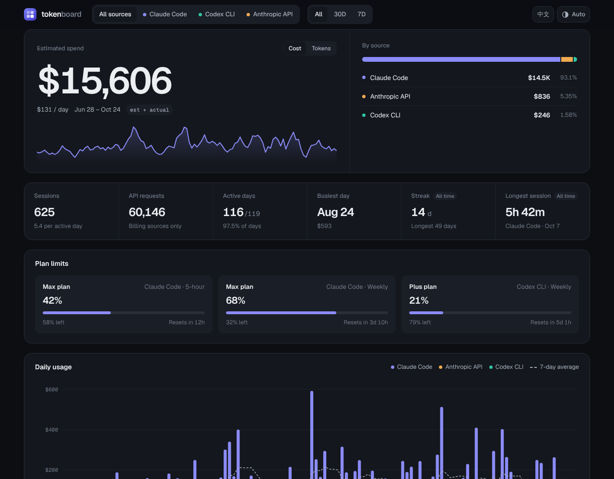

# tokenboard

A private, self-hosted dashboard for your AI usage: tokens, estimated cost, sessions and usage limits across
Claude Code and other tools, in one page. Light and dark themes, English and Chinese.

[中文说明](README.zh-CN.md)



## What you get

- **One number up top**: spend or tokens for the period, with the change against the previous period.
- **Breakdown by source and by model**, with input, output and cache tokens kept apart.
- **Daily chart** with a 7-day moving average; outlier days are capped so the rest stay readable.
- **Activity heatmap and activity by hour**: which days and hours you actually work.
- **Usage limits** as progress bars with reset times.
- Works on phones: touch to scrub charts, cards instead of wide tables.

The page is a single static HTML file. Your data is a JSON file next to it, produced by a collector that runs on
your own machine. Nothing is sent anywhere except where you deploy it.

## Quick start

Requires Python 3.9+ (for `zoneinfo`) and, to deploy, Node.js 18+.

```bash
git clone https://github.com/Taoshuke/tokenboard
cd tokenboard
cp tokenboard.config.example.json tokenboard.config.json   # set your time zone
python3 collector/collect.py                                # reads ~/.claude/projects
python3 scripts/build.py                                    # writes public/
python3 -m http.server -d public 8000                       # open http://localhost:8000
```

Without collected data the page shows built-in sample data and says so.

## Deploy

tokenboard deploys as a static-assets Cloudflare Worker on your own domain, protected by Cloudflare Access so only
you can open it. The collector runs on your machine and deploys with `wrangler`, so your usage never goes into
the repository. See [docs/deploy.md](docs/deploy.md).

Data can also live in Notion, so the site updates without a redeploy: see [docs/notion.md](docs/notion.md).

## Sources

| Source | Status | Reads |
| --- | --- | --- |
| Claude Code | supported | session logs in `~/.claude/projects` |
| Others (Codex CLI, API billing, usage limits) | planned | add an adapter, see below |

Adding a source means writing one module in `collector/sources/` that returns rows in the
[data format](docs/data-format.md), and registering it in `collector/sources/__init__.py`.

## How numbers are counted

Claude Code numbers match its own `/stats`: for the days `/stats` has computed, the collector takes tokens,
messages and sessions from `~/.claude/stats-cache.json`, and only the days after that are counted from the
session logs (there, subagents are included and a reply streamed over several lines counts once). Set
`"use_stats_cache": false` on the source to count everything from the logs instead. Costs from logs are estimates based on `prices.json`, which holds the providers' published
standard rates as of the `"checked"` date; update it when prices change. Billing sources can
report billed amounts, which the page marks `Billed`.

## Development

```bash
python3 -m unittest discover -s tests   # collector tests
python3 demo/generate.py                # regenerate sample data
python3 scripts/build.py --preview      # also writes public/preview.html, the bare page fragment
python3 scripts/compare_stats.py        # compare the collector's counts with Claude Code's /stats cache
```

## License

[MIT](LICENSE)
