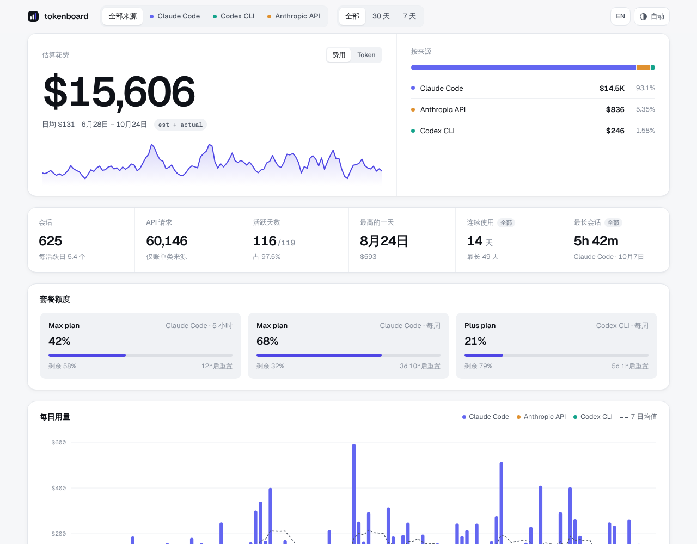

# tokenboard

自托管的私人 AI 用量看板。把 Claude Code 等工具的 token、预估费用、会话和用量限额汇总在一页里，支持深浅两种主题和中英两种语言。

[English](README.md)



## 功能

- **主指标** 所选时间段的花费或 token 总量，以及和上一个同长度周期的对比。
- **按来源、按模型的构成**，输入、输出、缓存读取、缓存写入分开统计。
- **每日柱状图** 叠加 7 日移动平均；个别特别高的日子会截顶显示，其余日子不被压扁。
- **活动热力图和时段分布** 看清自己在哪些日子、哪些钟点用得多。
- **用量限额** 用进度条显示已用比例和重置时间。
- **手机可用** 图表可以用手指拖动查看，宽表格在手机上换成卡片。

页面是一个静态 HTML 文件，数据是同目录下的一个 JSON 文件，由在你自己电脑上运行的采集脚本生成。除了你部署的位置，数据不会发往任何地方。

## 快速开始

需要 Python 3.9 及以上；部署还需要 Node.js 18 及以上。

```bash
git clone https://github.com/Taoshuke/tokenboard
cd tokenboard
cp tokenboard.config.example.json tokenboard.config.json   # 改成你的时区
python3 collector/collect.py                                # 读取 ~/.claude/projects
python3 scripts/build.py                                    # 生成 public/
python3 -m http.server -d public 8000                       # 打开 http://localhost:8000
```

没有采集数据时，页面显示内置的示例数据，并在顶部注明。

## 部署

tokenboard 以 Cloudflare Worker 静态站点的形式部署在你自己的域名上，用 Cloudflare Access 保护，只有你能打开。采集脚本在你的电脑上运行，用 `wrangler` 直接部署，用量数据不会进入代码仓库。详见 [docs/deploy.md](docs/deploy.md)。

数据也可以存在 Notion 里，网站不用重新部署就能更新，见 [docs/notion.md](docs/notion.md)。

## 数据来源

| 来源 | 状态 | 读取位置 |
| --- | --- | --- |
| Claude Code | 已支持 | `~/.claude/projects` 下的会话记录 |
| 其他（Codex CLI、API 账单、用量限额） | 计划中 | 写一个适配器即可，见下文 |

新增来源只需在 `collector/sources/` 里写一个模块，按[数据格式](docs/data-format.md)返回数据行，再在 `collector/sources/__init__.py` 里登记。

## 统计口径

Claude Code 的数字和它自带的 `/stats` 一致：`/stats` 已计算到的日期，token、消息数、会话数直接取自 `~/.claude/stats-cache.json`；之后的日期才从会话记录统计（含子代理，一条回复分多行写进记录的只计一次）。如果想全部从会话记录统计，在该来源的配置里设置 `"use_stats_cache": false`。会话记录类来源的费用按 `prices.json` 里的单价预估，单价取自各服务商公布的标准价格，核对日期见 `"checked"`，价格变动后需要更新。计费类来源可以提供实际金额，页面上标为“实际”。

## 开发

```bash
python3 -m unittest discover -s tests   # 采集脚本的测试
python3 demo/generate.py                # 重新生成示例数据
python3 scripts/build.py --preview      # 另外生成 public/preview.html，即不带文档外壳的页面片段
python3 scripts/compare_stats.py        # 对比采集脚本和 Claude Code /stats 缓存的统计结果
```

## 许可证

[MIT](LICENSE)
